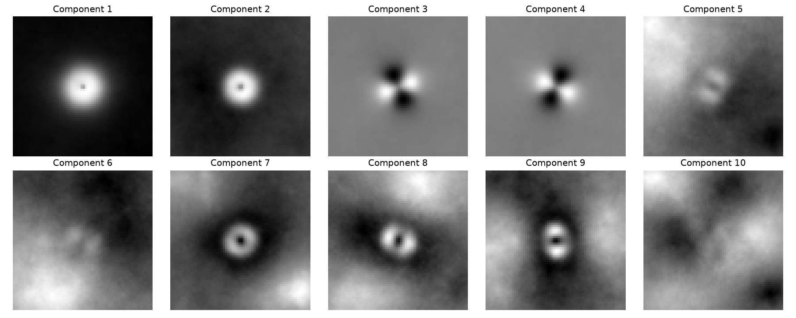

# EigenGalactic

Tool for analyzing datasets of galaxies to identify prominent patterns.

It learns an *eigengalaxy* basis from Galaxy Zoo 2 images with incremental PCA, then reconstructs a blurred galaxy by projecting it onto that basis.

**Try it in your browser:** [samuelindyk.com/demos/eigengalaxy](https://samuelindyk.com/demos/eigengalaxy/)



Trained on 4,952 Galaxy Zoo 2 images (64×64 grayscale). The first component (overall brightness) explains 19.3% of the variance, and all 100 components explain 73.8%. Components 3–4 are the two elongation modes, and the later ones pick up sky background and neighbouring sources.

## Setup

```sh
python -m venv .venv
.venv\Scripts\activate        # source .venv/bin/activate on macOS/Linux
pip install -r requirements.txt
```

The first run downloads Galaxy Zoo 2 (~2.7 GB) into `galaxy_data/` and caches the prepared images.

## Usage

- `python Eigengalactic.py`: train, show the mean galaxy, the eigengalaxies and the explained-variance plot, then optionally run the blur → reconstruct pipeline.
- `python export_web.py`: train the same model and write `web_export/eigengalaxies.{json,bin}` (mean, int8-quantised components, 48 held-out test galaxies) for the web demo.
- `Deblurring.html`: a standalone Richardson–Lucy deblurring app (QR codes, pixel art, astronomy shift-and-stack). Open it in a browser.
